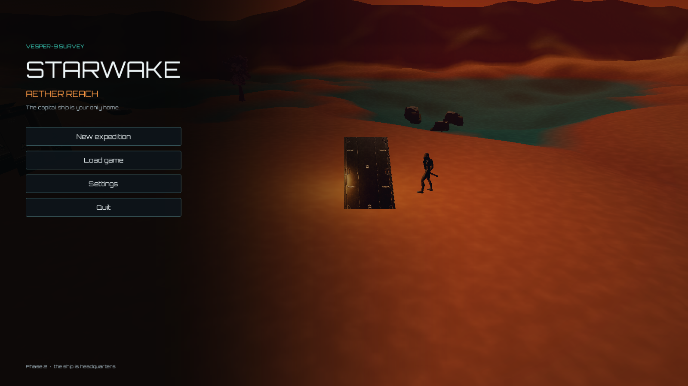
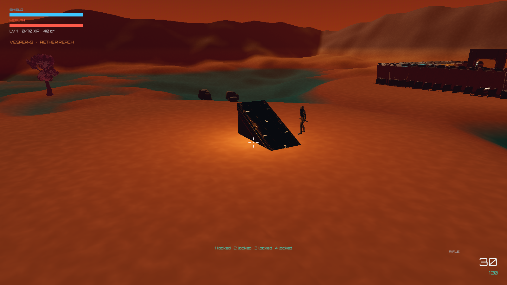
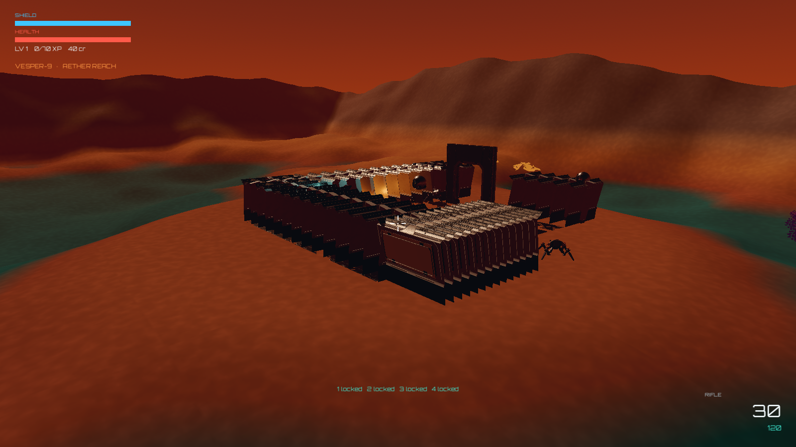
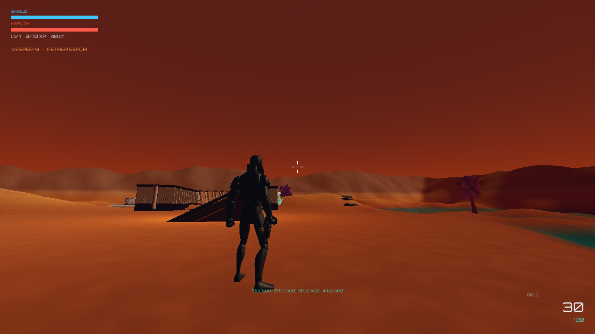

# Starwake

A PC sci-fi action RPG on the rust flats of **Vesper-9**. The pitch is "Skyrim in space": Starfield's range with a Mass Effect crew. Your ship is the headquarters — a capital ship in the Starfield / Normandy sense, not a starfighter and not a separate planetside base. You live aboard it, talk to crew there, pilot it from the bridge, and fight other ships with it. The valley outpost is a hostile site, not a home.

Godot **4.7.2** (stable) and GDScript. Later phases plug into the autoloads and groups instead of rewriting the player.

## Run

1. Install [Godot 4.7.2 or any later 4.7/4.8 stable](https://godotengine.org/download/archive/4.7.2-stable/). The project uses Forward+.
2. Open `project.godot`, or from a terminal:

```bash
godot --path .
```

3. Press F5. The main menu looks out over the valley. **Launch expedition** drops you next to the ship.
4. A headless boot check (no window, quits after a few frames):

```bash
godot --headless --path . --quit-after 60
```

The first launch imports glTF, textures, and audio. That takes longer than later launches.

## Controls

The input map is built at boot by `scripts/autoload/input_bindings.gd` (keyboard plus a standard Xbox-style pad).

| Action | Keyboard | Gamepad |
| --- | --- | --- |
| Move | W A S D | Left stick |
| Look | Mouse | Right stick |
| Jump | Space | A |
| Sprint | Shift | LB or left stick click |
| Dodge roll | Ctrl or Q | B or RB |
| Fire | Left mouse | RT |
| Aim | Right mouse | LT |
| Reload | R | X |
| Melee | F or V | Y |
| Interact | E | D-pad up |
| Abilities | 1 2 3 4 | D-pad left, down, right, Back |
| Inventory | I or Tab | |
| Skills | K | |
| Quests | J | |
| Pause | Esc | Start |

Aiming tightens the spring-arm camera and the crosshair. Shields absorb hits and recharge after a delay. The rifle has a magazine; reload or dry-fire when it is empty. Dodge rolls are briefly invulnerable.

At the capital ship's boarding ramp, interact opens the headquarters board. Rooms (med bay, armory, lab, quarters, galaxy map) are bought with credits and apply bonuses through the stats system. Walking the interior comes in the next phase. The ramp marker is `ShipHubSocket` on the `ship_hub` group.

## Settings

Esc, or Settings on the main menu. Mouse and gamepad sensitivity, invert Y, volumes, fullscreen, and screen shake are saved to `user://settings.cfg`.

**Mature content (18+)** is stored and does nothing else. Later phases will hide adult scenes behind it. This build has no mature content.

## Windows build

`export_presets.cfg` contains a Windows Desktop preset that writes `build/windows/Starwake.exe` plus `Starwake.pck`.

One-time template install for Godot 4.7.2:

```bash
mkdir -p ~/.local/share/godot/export_templates/4.7.2.stable
# Download Godot_v4.7.2-stable_export_templates.tpz from the 4.7.2 release.
unzip Godot_v4.7.2-stable_export_templates.tpz -d /tmp/godot-templates
cp -a /tmp/godot-templates/templates/. ~/.local/share/godot/export_templates/4.7.2.stable/
```

Export:

```bash
godot --headless --path . --export-release "Windows Desktop" build/windows/Starwake.exe
```

In the editor: Project, Export, Windows Desktop, Export Project. `build/` is gitignored.

Export with Godot 4.7.2 produces `build/windows/Starwake.exe` and `build/windows/Starwake.pck`. Keep them in the same folder and run the exe. A zip of that pair is attached to the pull request.

## Layout

```
scenes/     main, player, enemies
scripts/    autoload, player, combat, enemies, world, ui, vfx
assets/     models, audio, fonts
shaders/    terrain, stars, damage wash, menu
ui/         (theme is built in scripts/ui)
```

Autoloads:

| Singleton | Role |
| --- | --- |
| `EventBus` | Signals for damage, pause, prompts, settings. Later dialogue and quests subscribe here. |
| `GameState` | Phase, vitals, ammo, zone id. Empty slots for progression, inventory, quests, ship modules, and followers. |
| `Settings` | User config, including the mature-content flag. |
| `InputBindings` | Keyboard and gamepad map. |
| `AudioDirector` | Keyed sound effects and looping ambience. |

`HealthComponent` is the shield-first vitality model ships can reuse. Projectiles and the animator do not care whether the body is a person or a drone.

## Six phases

The ship is the only headquarters. There is no planetside base. Every upgradable room and the abilities it grants live aboard.

1. **Core feel.** Third-person move, aim, gun, melee, enemies, HUD, menus, one outdoor zone, day and night.
2. **RPG layer (this build).** Experience, levels, a four-branch skill tree, active abilities, inventory, loot, and saves. Ship rooms are commissioned at the ramp and write into `Stats` and `GameState.ship`. The surface outpost stays a hostile site.
3. **Ship interior.** The capital ship becomes a walkable, multi-room mobile base: bridge, med bay, armory and workbench, research lab, crew quarters, cargo, and galaxy map. You walk the decks, talk to crew, and pilot from the bridge. Upgrades you already own on `GameState.ship.rooms` become the rooms themselves. Still no separate ground headquarters.
4. **Ship combat.** The same capital ship fights other ships. You take the helm on the bridge. Combat reuses health, shields, and the weapon interface, including piloting perks from `Stats`.
5. **Dialogue and crew.** Conversations and followers live aboard. Persuasion and follower affinity are already stats. Companions reuse the character locomotion stack and are stored on `GameState.followers` and `GameState.crew`.
6. **Multi-zone open world.** The ship travels between worlds. `GameState.zone_id` is `vesper_9_aether_reach` until you leave the surface. The galaxy map room is the chart table for that.

## Assets

Every pack, license, and URL is in [ASSETS_CREDITS.md](ASSETS_CREDITS.md). Models are Quaternius CC0. Sounds and the secondary miner are Kenney CC0. The UI face is Orbitron (OFL).

## Screenshots

Captured from a software renderer (no SDFGI or volumetric fog). On a desktop GPU those stay enabled.









## Phase 2 controls

Buy skills with K. Abilities are locked until you spend a point: 1 shield burst, 2 grenade, 3 combat drone, 4 tactical slide. I opens inventory. E on the capital-ship ramp opens the headquarters board and spends credits on rooms. J is the quest list. Saves are in the pause menu. An autosave writes while you play and when you pause.

## Known limits

- One valley. No voiced conversation yet. Crew and followers are saved but not spawned.
- Ground enemies use a navigation mesh baked from static colliders. Drones still fly directly.
- The mature-content toggle does not change any scene.
- SDFGI, SSAO, and volumetric fog turn off when Godot reports a software renderer (lavapipe / llvmpipe), so a VM screenshot is flatter than a desktop GPU. On a normal GPU those features stay on: ACES tonemap, glow, a restrained color grade, and the day/night cycle (about four minutes) still run everywhere.
- The outpost is a walled hostile compound. The capital ship exterior is a landed hull with a boarding ramp; the walkable interior is the next phase. There is no separate planetside base.
- The surveyor is still the CC0 mannequin, now with armor plates on the skeleton. A matching textured sci-fi body was not in the free packs.
- Ambience is ship and wind-like engine loops. There is no music score in the CC0 packs used here.
